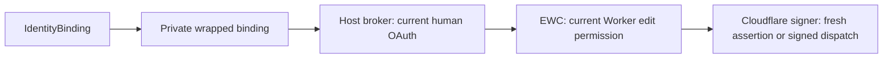

# Shared authenticated development tooling

Wrangler, Vite and Vitest use this package for remote sessions and local identity
brokers. `identities` and `bindings.identity()` configure the same limits.

```ts
IDENTITY: bindings.identity({
	audience: "urn:inventory",
	authorization_grants: {
		allowed_authorization_servers: ["https://auth.example.com"],
		allowed_scopes: ["items:read"],
	},
	request_signing: {
		allowed_origins: ["https://api.example.com"],
		allowed_methods: ["GET", "POST"],
	},
});
```



| Method                           | Result                                              |
| -------------------------------- | --------------------------------------------------- |
| `getToken()`                     | Fresh five-minute JWT for the fixed audience        |
| `getAuthorizationGrant(options)` | Fresh WAG within the configured AS/scope limits     |
| `fetch(input, init?)`            | Sign and dispatch to an allowed HTTPS origin/method |

Require `workers_oidc` and an existing linked Worker. Local Durable Objects share
the Worker's development identity. Local namespace subjects remain unavailable.

## Authentication and lifetime

- `getDevelopmentOidcAuthHook()` reads human OAuth on every operation.
- Vite uses the project's `cf` profile. Wrangler uses its selected credential store.
- `cf dev` forwards profile selection through `CLOUDFLARE_CF_AUTH` and
  `CLOUDFLARE_DEV_AUTH_PROFILE`. Neither variable carries credentials.
- API tokens, global keys and temporary accounts cannot replace human OAuth.
- Cache only the eight-hour session. Never cache assertions or coalesce issuance.
- Cancel pending requests when credentials/configuration change or the host stops.

The host bounds pending operations, request bodies and token responses. Signed
fetch checks destination limits before reading the body, rejects redirects, and
preserves response streaming and cancellation. Keep credentials and broker
capabilities outside application bindings and logs.

## Tests and programmatic consumers

Vitest requires `developmentOidc: true` for live issuance. Programmatic Wrangler
consumers also opt in explicitly. Offline tests can supply a host broker:

```ts
miniflare: {
  developmentOidc: {
    key: "offline-test",
    create: () => ({
      invoke: async () => new Response(fixtureJwt),
      dispose() {},
    }),
  },
}
```

Modern Miniflare accepts this option at `workers[].dev.developmentOidc`. Configure
the corresponding `identity` binding in `workers[].config.env`.

## Enablement

Use the runtime's existing wrapped-binding/RPC serializer. No native OIDC
callback or schema extension is required. The local Miniflare suite runs against
the pinned npm runtime.

Live issuance also needs EWC's authenticated session/operation endpoints, API
Gateway routes and the Cloudflare signer/discovery Workers. Account opt-in,
protected key provisioning, live canaries, provider tests and security/performance
review remain release gates.
